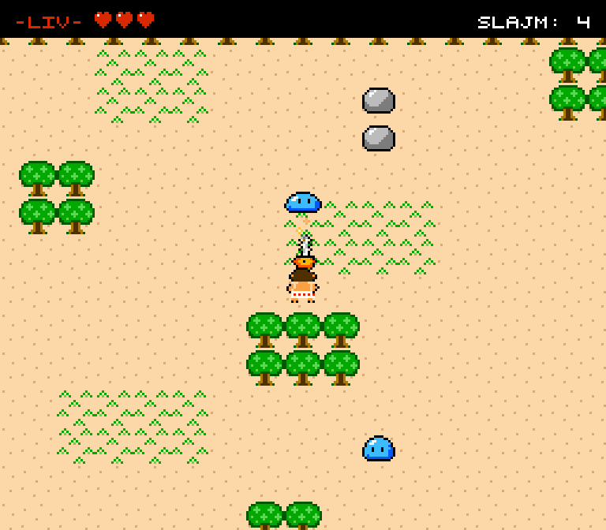

# Mini-Zelda i Phaser 3 (8-bit)

Ett litet top-down-äventyr i NES-stil, byggt från grunden med [Phaser 3](https://docs.phaser.io/) (v3.90.0).
Hjälten har varken tunika eller mössa – bara kalsonger – och slåss med en motorsåg.
All grafik – hjälten, slajmen, motorsågen, träden, hjärtan och till och med typsnittet – ritas **i kod** som små
pixel-matriser. Inga bildfiler, inget byggsteg. Ljudet till sågen skapas i webbläsaren, utan ljudfiler.



## Starta spelet

Koden använder ES-moduler, så sidan måste öppnas via en lokal webbserver (att dubbelklicka på
`index.html` fungerar inte). Stå i projektmappen och kör **ett** av dessa:

```bash
python3 -m http.server 8000
# öppna sedan http://localhost:8000
```

```bash
npx serve .
# öppna adressen som skrivs ut (oftast http://localhost:3000)
```

Phaser laddas från jsDelivr, så du behöver internet första gången.

## Kontroller

| Tangent                | Vad som händer                                                         |
|------------------------|------------------------------------------------------------------------|
| Mellanslag eller Enter | På titelskärmen: starta spelet                                         |
| Piltangenter / WASD    | Gå åt fyra håll                                                        |
| Mellanslag (håll inne) | Kör motorsågen åt det håll du tittar. Du kan gå långsammare samtidigt. |
| R                      | Börja om spelet (efter game over eller vinst, inte via titeln)         |

Du har tre hjärtan (varje träff kostar ett halvt). Slajmen tål tre träffar från motorsågen, kulbjörnen tål fyra. Håll sågen mot dem en kort stund. Besegra alla fiender för att vinna!

## Filstruktur

```
zelda-phaser/
├── index.html              Laddar Phaser från CDN och startar src/main.js
├── README.md
├── screenshot.png
└── src/
    ├── main.js             Spelets inställningar (256x224, pixelArt, skalning, fysik, scener)
    ├── art/
    │   ├── palette.js      Den begränsade NES-paletten (ett tecken = en färg)
    │   ├── sprites.js      All grafik som 16x16-pixelritningar i text
    │   ├── makeTextures.js Gör om ritningarna till texturer + skapar animationer
    │   └── font.js         Eget 5x5 pixel-typsnitt (med Å, Ä, Ö) som RetroFont
    ├── data/
    │   └── map.js          Kartan (40x30 rutor) ritad med tecken – lätt att ändra!
    ├── scenes/
    │   ├── BootScene.js    Skapar grafik/typsnitt/animationer och startar titeln
    │   ├── TitleScene.js   Titelskärm: solnedgång, silhuett, blinkande starttext
    │   ├── GameScene.js    Världen: karta, kamera, kollisioner, game over/vinst
    │   └── UIScene.js      HUD: hjärtan, antal fiender och meddelanden
    └── entities/
        ├── Player.js       Hjälten: rörelse, motorsåg, skada, knuff, osårbarhet
        ├── Slime.js        Fienden: slumpvis vandring, träffar och död
        └── Kulbjorn.js     Kulbjörnen: två bollar i en säck, som vaggar och studsar
```

Tips: sätt `debug: true` i `src/main.js` så ser du alla kollisionslådor.

## Förslag på nästa steg

1. **Rita om världen** – ändra i `src/data/map.js`, eller lägg till en ny rut-typ (t.ex. buskar `B`)
   genom att rita den i `sprites.js`, skapa texturen i `makeTextures.js` och lägga till den i `WALL_TILES`.
2. **Föremål att plocka upp** – låt döda slajm ibland tappa ett hjärta som ger tillbaka liv
   (en ny sprite + `physics.add.overlap` mellan hjälten och hjärtat).
3. **Fler fiender** – gör en ny klass som jagar hjälten när den är nära
   (`this.scene.physics.moveToObject(this, player, speed)`), eller skjuter projektiler.
4. **Ljud och flera rum** – lägg till ljudeffekter (`this.sound`) och låt hjälten gå
   in i en grotta/ny karta när den kliver på en viss ruta (starta om scenen med en annan karta).
